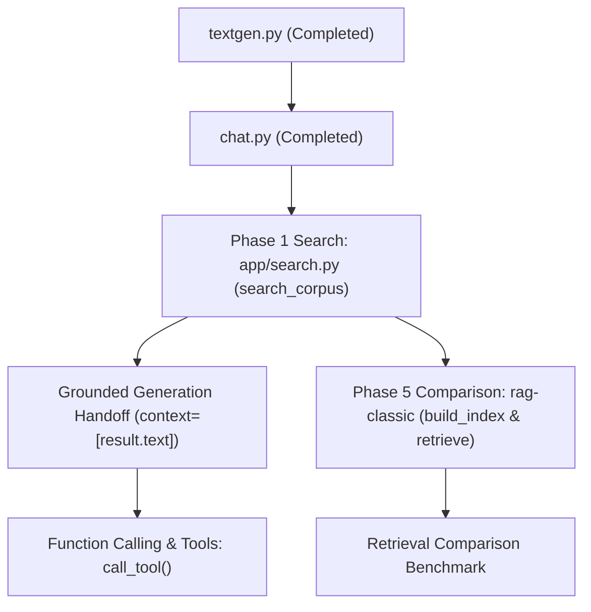

# Project Thread: Multi-Turn Chat & Generation Architecture Plan

## 1. Overview & Architectural Context
This document tracks the technical roadmap, architectural decisions, completed work, and upcoming steps for the `project-thread-api/v1` application suite.

The system is centered around [`textgen.py`](textgen.py), which serves as the core, stateless generation boundary for all downstream components (such as the conversational adapter [`chat.py`](chat.py) and future tool/agent runtimes).

---

## 2. Key Architectural Decisions Made

| Decision Area | Choice | Rationale |
| :--- | :--- | :--- |
| **API Protocol** | **OpenAI Chat Completions API** (`chat.completions.create`) | Universal cross-provider standard. Ensures zero-friction portability across Azure OpenAI, standard OpenAI, Ollama, vLLM, and local SLM experiments. |
| **Context Grounding** | **Approach B: Prompt-Fenced Evidence Block** | Documents are formatted into `<context>` XML tags attached to the user query with explicit guard instructions. Prevents untrusted corpus text from masquerading as system-level instructions (indirect prompt injection defense). |
| **Domain Stream Entity** | **`TextStream` in `domain/models.py`** | Elevated `TextStream` to a first-class domain model implementing `Iterator[str]`. Adheres to strict lifecycle: yields display chunks during iteration; `stream.result` is accessible only upon stream exhaustion (premature access raises `RuntimeError`). |
| **Configuration Isolation** | **Dedicated `config.py`** | Keeps credentials (`AZURE_OPENAI_API_KEY`, `OPENAI_API_KEY`), endpoints, and client instantiation strictly internal. `generate_text` accepts no client or credential arguments. Callers can override `model` without altering globals. |
| **Domain Error Translation** | **`ModelError` from `domain/errors.py`** | Any backend network failure, authentication issue, or stream interruption is caught and raised as a domain `ModelError`, isolating callers from third-party vendor exception hierarchies. |
| **Tool Invocations Correlation** | **Migration (v3.8): `call_uid`** | Unified correlation identifier under `call_uid` across `ToolCall.call_uid`, `ToolResult.call_uid`, and `Message.call_uid`. Enforces "one value, one name, three fields" rule; preserved unchanged even on failure; no aliases kept. |
| **Test Structure** | **Dedicated `tests/unit/` & `tests/integration/`** | Separated test suites into dedicated directories outside `app/`, ensuring standard discoverability via `python -m unittest discover tests`. |

---

## 3. Completed Phases & Checklists

### Phase 1 — Discovery & Requirements
- [x] Inspect existing domain contracts (`domain/models.py`, `domain/invariants.py`, `domain/errors.py`)
- [x] Establish boundary guarantees and forbidden inputs for `generate_text`
- [x] Decide API protocol (Chat Completions API)
- [x] Select context injection strategy (Approach B)

### Phase 2 — Threat Modeling & Boundary Defenses
- [x] Prevent indirect prompt injection in retrieved passages via `<context>` XML delimiters and advisory framing
- [x] Enforce non-empty trimmed `prompt` validation (`ValueError` on empty or whitespace strings)
- [x] Restrict `history` roles to conversation messages (`role="system"` is rejected)
- [x] Enforce "Unknown is not zero" rule (`tokens_in`, `tokens_out`, and `est_cost` remain `None` when unavailable)
- [x] Ensure forbidden inputs (credentials, client objects, corpus paths) do not cross into `textgen.py`

### Phase 3 — Architecture & Design
- [x] Design and implement `TextStream` in [`domain/models.py`](domain/models.py)
- [x] Export `TextStream`, `ModelError`, and domain exceptions in [`domain/__init__.py`](domain/__init__.py)
- [x] Implement [`config.py`](config.py) supporting `azure` and `openai` modes and default model resolution
- [x] Design message assembly helper preserving system ownership, history sequence, and context evidence

### Phase 4 — Implementation (`textgen.py`)
- [x] Implement `generate_text(...) -> GenerationResult`
- [x] Implement `generate_text_stream(...) -> TextStream`
- [x] Implement stream usage accumulation and finish reason mapping
- [x] Translate backend exceptions to `ModelError`
- [x] Add demo loop guarded strictly under `if __name__ == "__main__":`

### Phase 5 — Review & Debugging
- [x] Create comprehensive unit test suite in [`../tests/unit/test_textgen.py`](../tests/unit/test_textgen.py)
- [x] Test input validation, boundaries, message ordering, mock execution, and stream lifecycle
- [x] Test `ModelError` propagation on client/stream failures
- [x] Run full unit test suite (16 tests passed in 0.006s)
- [x] Perform live end-to-end verification against live endpoint (`gpt-4o-2024-08-06`) for both synchronous and streaming calls

---

## 4. Next Steps Roadmap

### Phase 6 — `chat.py` Core Implementation
- [x] Create [`chat.py`](chat.py)
- [x] Implement `respond(history: list[Message], system_prompt: str) -> GenerationResult`:
  - [x] Invariant: Validate `history` is non-empty and `history[-1].role == "user"`
  - [x] Unpack `history[-1].content` as `prompt` and `history[:-1]` as `history` for `generate_text`
  - [x] Invariant: Non-mutation guarantee (never mutate caller's `history` list)
  - [x] Return standard `GenerationResult`
- [x] Implement `respond_stream(history: list[Message], system_prompt: str) -> TextStream`

### Phase 7 — Interactive Console Adapter (`chat_loop`)
- [x] Implement `chat_loop()` in [`chat.py`](chat.py) callable via `python app/chat.py`:
  - [x] Maintain session history explicitly: append user query and assistant reply
  - [x] Implement `/reset` command:
    - [x] Replaces in-memory history with an empty list `[]`
    - [x] Emits reset confirmation
    - [x] Invariant: Next turn has no memory of prior turns
  - [x] Implement exit commands (`/exit`, `/quit`, EOF/`Ctrl+D`, `Ctrl+C`)
  - [x] Integrate streaming chunk display using `generate_text_stream`:
    - [x] Ensure streamed timing affects only display; final stored text matches `stream.result.text`
  - [x] Add `if __name__ == "__main__": chat_loop()`

### Phase 8 — Chat Verification & Testing Suite
- [x] Create [`../tests/unit/test_chat.py`](../tests/unit/test_chat.py):
  - [x] Test `respond` positive path (multi-turn history)
  - [x] Test `respond` negative path (empty history or `history[-1].role != "user"`)
  - [x] Test immutability: verify input `history` list identity and contents remain unchanged
  - [x] Test `/reset` behavior in isolated loop runner
  - [x] Test non-streaming mode
- [x] Test live terminal interaction (`python app/chat.py`) (verified multi-turn + `/reset` + exit)
- [x] Run full regression test suite (24 tests passed across unit suites)

### Phase 9 — Retrieval API: `app/search.py` (Phase 1 Search Owner)
- [x] Add `IndexManifest` to [`domain/models.py`](domain/models.py) and export in [`domain/__init__.py`](domain/__init__.py):
  - [x] Fields: `index_version`, `embedding_model_id`, `document_count`, `chunk_count`, `chunk_tokens`, `overlap_tokens`, `created_from`
- [x] Implement embedding provider adapter in [`config.py`](config.py) / [`search.py`](search.py):
  - [x] Enforce Comparability rule: shared `embedding_model_id` (`text-embedding-3-small`) across Phase 1, Phase 5, and Agentic retrieval
- [x] Implement `search_corpus(query: str, top_k: int = 5) -> list[SearchResult]` in [`search.py`](search.py):
  - [x] Query rule: empty query returns `[]` (never arbitrary documents)
  - [x] Ordering rule: strictly best -> worst by cosine similarity
  - [x] Cosine tolerance: check tolerance $\le 0.001$ verified with NumPy
  - [x] File ingestion: support `.txt`, `.md`, `.json`, and `.pdf` (with `pypdf`) recursively across subdirectories
  - [x] Incremental disk caching (`.corpus_cache.json`): embeds only new or modified files, invalidates deleted files
  - [x] Metadata guard: populate `source_filename`, `chunk_id`, `text`, `score`, `metadata` (no credentials)
- [x] Create unit tests in [`../tests/unit/test_search.py`](../tests/unit/test_search.py):
  - [x] Empty query boundary handling
  - [x] Cosine similarity calculation tolerance ($0.001$) and ordering checks
  - [x] Top-k truncation bounds
  - [x] Incremental cache hit test (verifying zero embedding calls on unchanged corpus)
- [x] Run full regression test suite (33 tests passing across unit test packages)
- [x] Live search verification on `corpus/genai-beginners-01-02.txt`

### Phase 10 — Classic RAG Indexing & Comparison (Phase 5 Owner: `rag-classic/`)
- [ ] Implement `build_index(corpus_path: str, *, embedding_model: str | None = None) -> IndexManifest` in `rag-classic/build_index.py`:
  - [ ] Chunk rule: document structure split first, then ~500-token windows with ~50-token overlap
  - [ ] Deterministic `chunk_id` derived from source filename + chunk index/hash
  - [ ] Index rule: rebuild FAISS index at startup unless index artifact explicitly selected; manifest records settings
- [ ] Implement `retrieve(query: str, top_k: int = 5) -> list[SearchResult]` in `rag-classic/query.py`:
  - [ ] Enforce identical output type (`SearchResult`) and ordering invariants as `search_corpus`
- [ ] Comparison benchmark: test Phase 1 vs. Phase 5 on shared query test cases

### Phase 11 — Generation Handoff & Grounded QA
- [x] Wire caller-side retrieval handoff in [`chat.py`](chat.py):
  - [x] Amend `respond(history, system_prompt, context=None)` to forward `context` unchanged to `generate_text`
  - [x] Amend `respond_stream(history, system_prompt, context=None)` to forward `context` unchanged to `generate_text_stream`
  - [x] Enforce one-module-one-job seam: `textgen.py` never opens corpus or runs retrieval; `search_corpus` remains in `search.py`
  - [x] Pass rank-ordered document text strings (`[r.text for r in results]`), not `SearchResult` objects
  - [x] Invariant: Keep `history`, `context`, and `system_prompt` strictly distinct (context does not mutate history or override system prompt)
  - [x] Add optional grounded retrieval preview to `chat_loop()` via `--search`/`--rag` CLI flag and `/search` toggle command
- [x] Unit tests in [`../tests/unit/test_chat.py`](../tests/unit/test_chat.py) verifying context forwarding and loop search grounding
- [x] Full regression test run (37 tests passing across unit suites)

### Phase 12 — Function Calling & Tool API (Phase 7 Milestone)
- [x] Migration (v3.8): Unified `call_uid` across `ToolCall.call_uid`, `ToolResult.call_uid`, and `Message.call_uid`
- [x] Define `ToolDefinition` in [`domain/models.py`](domain/models.py) and export in [`domain/__init__.py`](domain/__init__.py)
- [x] Implement [`app/tools.py`](tools.py):
  - [x] Centralized `ToolRegistry` (snake_case names, unique registration, code-side handler isolation)
  - [x] Implement `call_tool(name: str, arguments: dict, call_uid: str | None = None) -> ToolResult`:
    - [x] Untrusted model input validation: check tool existence in registry (`UNKNOWN_TOOL`)
    - [x] Payload type validation: reject non-dict payloads (`MALFORMED_ARGUMENTS`)
    - [x] Schema validation via `jsonschema`: validate required fields and types (`SCHEMA_VALIDATION_ERROR`)
    - [x] Forbid undeclared arguments by default unless `additionalProperties: True`
    - [x] Least privilege execution: execute handler with validated arguments only
    - [x] Error containment: handler crashes wrapped safely as `EXECUTION_ERROR` without crashing process
    - [x] Correlation invariant: `call_uid` preserved unchanged on both success and failure paths
  - [x] Reference starter tools:
    - [x] `search_corpus`: knowledge corpus cosine retrieval
    - [x] `calculate`: safe AST-parsed mathematical evaluator
    - [x] `get_current_time`: ISO 8601 UTC timestamp and date utility
  - [x] `get_openai_tools()`: format tools for LLM function calling (handler callable never serialized)
  - [x] Persistent configuration via [`tools_config.json`](tools_config.json): enable/disable tools at runtime
  - [x] Standalone test runner and management CLI under `if __name__ == "__main__": main()`
  - [x] Explicitly catch and translate `ToolExecutionError` from `domain/errors.py` into `ToolError(code="EXECUTION_ERROR")`
- [x] Unit test suite in [`../tests/unit/test_tools.py`](../tests/unit/test_tools.py) (15 tests verifying schemas, error codes, least privilege, parallel invocation correlation, starter tools, ToolExecutionError translation, and persistent enable/disable lifecycle)
- [x] Complete documentation suite created: [`../README.md`](../README.md) and 10 detailed markdown documents in [`../docs/`](../docs/)
- [x] Run full regression test suite (52 tests passing across unit suites in 0.030s)

### Phase 13 — Autonomous Agent Loop & Function Calling (Upcoming)
- [ ] Implement multi-step agent execution engine:
  - [ ] Support iterative decide $\to$ tool invocation $\to$ observation loop
  - [ ] Feed `ToolResult` observations back into LLM context as `Message(role="tool", call_uid=...)`
  - [ ] Conformance testing against function-calling evaluation suites (minimum 30 held-out prompts)

