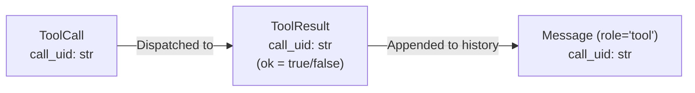

# Domain Models Reference (`project-thread-api/v1`)

**Location:** [`app/domain/models.py`](../app/domain/models.py)  
**Contract Version:** `project-thread-api/v1`

---

## 1. Migration (v3.8) & The `call_uid` Rule

### The "One Value, One Name, Three Fields" Matching Rule
Under Migration (v3.8), the joining correlation identifier across tool invocations has been unified to a single field name: **`call_uid`**.



- **`ToolCall.call_uid: str`** (formerly `call_id` / `id`): Minted or supplied when the model proposes an invocation.
- **`ToolResult.call_uid: str`** (formerly `call_id`): Preserved unchanged from the call it answers—even on failure paths (`ok = False`).
- **`Message.call_uid: str | None`** (formerly `tool_call_id`): Populated when `role == "tool"` to correlate the observation with its originating call.
- **Zero Aliases**: Old names (`call_id`, `tool_call_id`) are deprecated and removed.

---

## 2. Core Domain Data Classes

### `Message`
Represents an individual message in a conversation.
```python
@dataclass(frozen=True)
class Message:
    role: Literal["system", "user", "assistant", "tool"]
    content: str
    name: str | None = None
    call_uid: str | None = None                      # Populated when role == 'tool'
    tool_calls: tuple[ToolCall, ...] | None = None   # Populated when role == 'assistant'
```
*Ordering Invariant:* Collections of messages must be ordered oldest $\to$ newest.

---

### `GenerationResult`
Immutable result returned from `generate_text` and completed `TextStream`s.
```python
@dataclass(frozen=True)
class GenerationResult:
    text: str
    model_id: str
    tokens_in: int | None
    tokens_out: int | None
    est_cost: float | None
    finish_reason: Literal["stop", "length", "tool_calls", "content_filter", "error"]
    tool_calls: tuple[ToolCall, ...] | None = None   # Populated when finish_reason == 'tool_calls'
```
*The Null Rule:* Unknown token metrics and costs are `None`, never `0` or estimated.

---

### `TextStream`
First-class iterator yielding real-time text chunks.
```python
class TextStream(Iterator[str]):
    # Iterates string chunks as they arrive from the backend
    def __iter__(self) -> "TextStream": ...
    def __next__(self) -> str: ...

    @property
    def is_exhausted(self) -> bool: ...

    @property
    def result(self) -> GenerationResult: ...
```
*Option A Invariant:* Accessing `stream.result` before exhausting all chunks raises `RuntimeError`.

---

### `SearchResult`
Result item produced by `search_corpus` and classic RAG `retrieve`.
```python
@dataclass(frozen=True)
class SearchResult:
    source_filename: str
    chunk_id: str | None        # In Phase 1: f"{source_filename}:0"
    text: str
    score: float                # Cosine similarity (higher = more relevant)
    metadata: dict[str, Any]    # subdirectory, extension, character count
```
*Ordering Invariant:* Search results are strictly sorted best $\to$ worst.

---

### `IndexManifest`
Manifest recording vector index configurations for classic RAG (Phase 5).
```python
@dataclass(frozen=True)
class IndexManifest:
    index_version: str
    embedding_model_id: str
    document_count: int
    chunk_count: int
    chunk_tokens: int
    overlap_tokens: int
    created_from: str
```

---

### `ToolDefinition`
Declaration of a tool executable by agents or callers.
```python
@dataclass(frozen=True)
class ToolDefinition:
    name: str                   # snake_case, unique in registry
    description: str            # Purpose for model prompt
    input_schema: dict[str, Any]# JSON Schema (type: "object")
    handler: Callable[..., Any] # Code-side only, never serialized to model
```

---

### `ToolCall`
Tool invocation requested by the model.
```python
@dataclass(frozen=True)
class ToolCall:
    call_uid: str
    name: str
    arguments: dict[str, Any]
```

---

### `ToolResult` & `ToolError`
Safe boundary object returned from `call_tool`.
```python
@dataclass(frozen=True)
class ToolError:
    code: str
    message: str

@dataclass(frozen=True)
class ToolResult:
    call_uid: str
    name: str
    ok: bool
    content: str
    data: dict[str, Any] | None = None
    error: ToolError | None = None
```

---

## 3. Domain Exceptions (`domain/errors.py`)

- `AgentError`: Base exception for all agent domain failures.
- `ModelError`: Backend network, provider API, or streaming interruption failures.
- `SearchError`: File reading or embedding generation failures.
- `ToolExecutionError`: Tool execution errors across boundary interfaces.
- `GuardrailError`: Policy or security permission violations.

