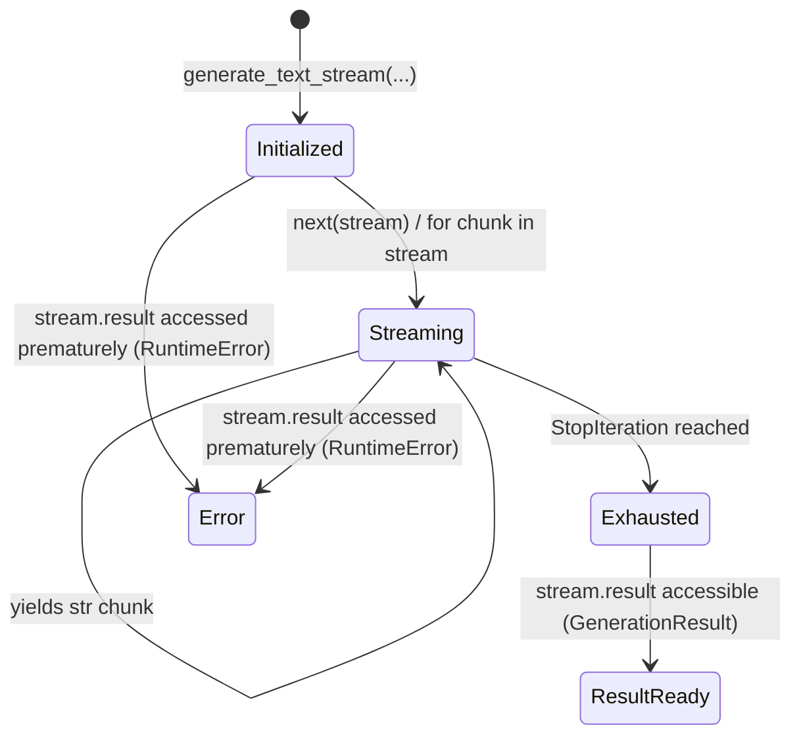

# `generate_text_stream`

**Module:** [`app/textgen.py`](../app/textgen.py)  
**Contract Version:** `project-thread-api/v1`

---

## 1. Overview
`generate_text_stream` provides real-time streaming of generated text. It shares identical inputs and validation with `generate_text`, returning an iterator [`TextStream`](domain_models.md#textstream) that yields string chunks as they arrive from the backend model.

---

## 2. Function Signature

```python
def generate_text_stream(
    prompt: str,
    *,
    system_prompt: str | None = None,
    history: list[Message] | None = None,
    context: list[str] | None = None,
    model: str | None = None,
    temperature: float | None = None,
    max_tokens: int | None = None,
) -> TextStream:
```

### Parameters
Parameters are identical to [`generate_text`](generate_text.md):
- `prompt: str` (trimmed non-empty)
- `system_prompt: str | None`
- `history: list[Message] | None`
- `context: list[str] | None`
- `model: str | None`
- `temperature: float | None`
- `max_tokens: int | None`

### Return Value
Returns a [`TextStream`](domain_models.md#textstream) instance implementing `collections.abc.Iterator[str]`.

---

## 3. Invariants & Lifecycle Guarantees



1. **Option A Invariant (Premature Access Guard)**:
   Accessing `stream.result` before exhausting all chunks raises `RuntimeError`:
   ```python
   stream = generate_text_stream("Prompt")
   # RuntimeError: Stream is not exhausted yet. Consume all chunks before accessing result.
   res = stream.result
   ```
2. **Display Timing Invariance**:
   Streaming changes display timing only. The assembled text from consuming all chunks and the final `stream.result.text` represent the identical logical completion (subject to normal model non-determinism).
3. **Usage Accumulation**:
   Token metrics (`tokens_in`, `tokens_out`) and the actual `model_id` emitted across streaming chunks are accumulated and populated on `stream.result` upon stream termination.

---

## 4. Usage Example

```python
from textgen import generate_text_stream

stream = generate_text_stream(
    "Write a short haiku about neural networks.",
    temperature=0.7,
)

print("Streaming output: ", end="", flush=True)
for chunk in stream:
    print(chunk, end="", flush=True)
print("\nStream finished.\n")

# Access final GenerationResult after exhaustion
result = stream.result
print(f"Model ID   : {result.model_id}")
print(f"Total Text : {result.text}")
print(f"Tokens in  : {result.tokens_in}")
print(f"Tokens out : {result.tokens_out}")
print(f"Finish     : {result.finish_reason}")
```

