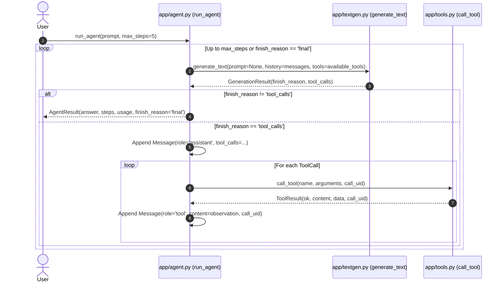

# `run_agent` Function Specification

**Target File:** [`app/agent.py`](../app/agent.py)  
**Contract Version:** `project-thread-api/v1`

---

## 1. Overview
The `run_agent(...)` function implements an autonomous ReAct decision-execution loop for `project-thread-api/v1`. It orchestrates stateless LLM generation (`textgen.py`) and schema-validated tool execution (`tools.py`) to answer queries that require multi-step reasoning, calculations, or knowledge base searches.



---

## 2. Function Signature

```python
def run_agent(
    prompt: str,
    *,
    system_prompt: str | None = None,
    max_steps: int = 5,
    tools_definitions: list[dict[str, Any]] | None = None,
    model: str | None = None,
) -> AgentResult:
```

---

## 3. Parameter Specifications

| Parameter | Type | Required | Description |
| :--- | :--- | :--- | :--- |
| `prompt` | `str` | Yes | Non-empty user query or instruction after trimming. |
| `system_prompt` | `str \| None` | No | Optional system instructions configuring agent persona or behavior. |
| `max_steps` | `int` | No | Positive integer representing maximum model decide rounds (default: 5). |
| `tools_definitions`| `list[dict] \| None` | No | List of OpenAI tool schemas. Defaults to `tools.get_openai_tools()`. |
| `model` | `str \| None` | No | Target model identifier. Defaults to backend configuration. |

---

## 4. Return Value: `AgentResult`

Returns a domain [`AgentResult`](../app/domain/models.py) instance:

```python
@dataclass(frozen=True)
class AgentResult:
    answer: str
    trace_id: str
    steps: int
    sources: list[SearchResult]
    tool_calls: list[ToolCall]
    usage: Usage
    finish_reason: Literal["final", "max_steps", "tool_error", "guardrail_blocked", "model_error"]
```

---

## 5. Contract Guarantees & Invariants

1. **Step Semantics:** `steps` counts generation/decision rounds (calls to `generate_text`), not individual tool calls.
2. **Correlation Matching (Migration v3.8):** Every tool execution preserves `ToolCall.call_uid == ToolResult.call_uid == Message.call_uid`.
3. **The Null Rule:** Unknown token counts or unpriced costs remain `None` in `usage`, never `0` or estimated.
4. **Tool Error Containment:** A failing tool execution (`ToolResult.ok = False`) does not crash the loop. An informative error observation is appended to the scratchpad, allowing the model to recover or report the limitation.
5. **Retrieval Source Preservation:** When `search_corpus` is executed, retrieved documents are parsed and recorded in `AgentResult.sources`.
6. **Max Steps Guard:** If the model continues proposing tool calls beyond `max_steps`, the loop cleanly terminates with `finish_reason = "max_steps"`.

---

## 6. Example CLI Usage

```bash
# Run calculation and date query
python app/agent.py "What is 1542 multiplied by 38 plus 419, and what is the current UTC date?"

# Run knowledge retrieval query
python app/agent.py "According to the corpus documents, what are key aspects of transitioning to an AI engineer?"
```

